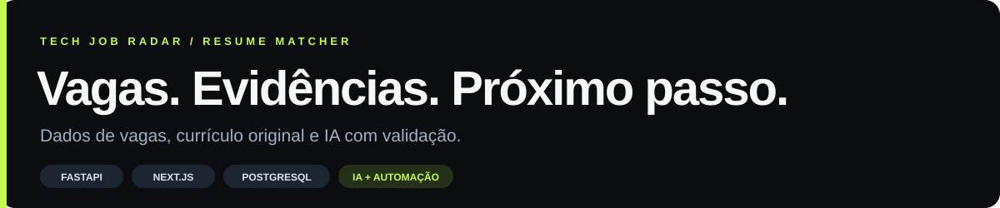
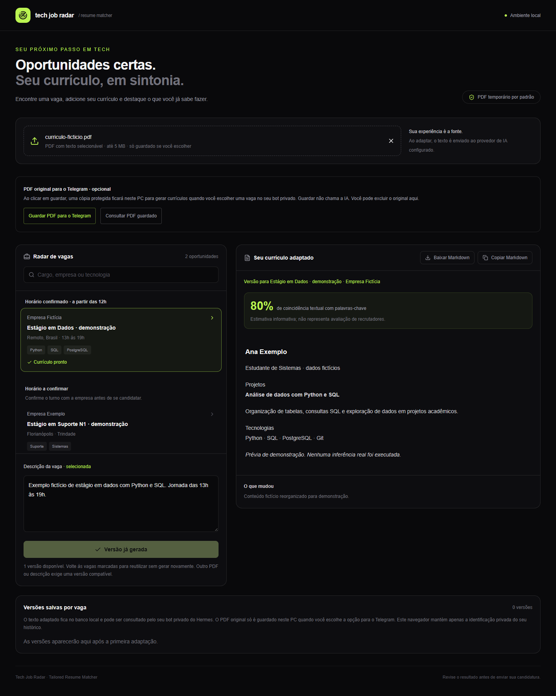
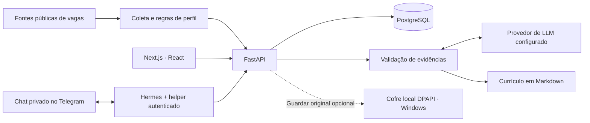

<p align="center">
  
</p>

<p align="center">
  <a href="https://github.com/Bernardo-03P/job_radar/actions/workflows/ci.yml"></a>
  
  
  
</p>

# Job Radar

**Uma aplicação local para organizar vagas de tecnologia e adaptar currículos com IA, mantendo o documento original como fonte de evidências.**

O projeto combina uma API em FastAPI, uma interface em Next.js e PostgreSQL. A integração opcional com Hermes e Telegram permite consultar vagas e solicitar uma adaptação para uma oportunidade escolhida, com os serviços iniciados sob demanda.

[Funcionalidades](#funcionalidades) · [Arquitetura](#arquitetura) · [Executar localmente](#executar-localmente) · [Testes](#testes-e-qualidade) · [Documentação](#documentação)

## Demonstração



*Captura produzida com empresas e currículo fictícios e resposta de IA simulada. Nenhum currículo pessoal, credencial ou mensagem de Telegram foi utilizado. O percentual exibido é ilustrativo e não representa aprovação em processos seletivos.*

## Funcionalidades

- **Radar de vagas:** coleta em fontes públicas, validação de dados e deduplicação por URL canônica, incluindo links compartilháveis da Gupy.
- **Perfil configurável:** estágio/trainee, áreas de interesse, modalidade, localização e disponibilidade de horário.
- **Dois grupos de horário:** oportunidades confirmadas e oportunidades cujo turno precisa ser esclarecido. Jornadas incompatíveis são excluídas; pendentes não completam a meta de confirmadas.
- **Adaptação com evidências:** o LLM propõe uma organização do currículo; o servidor valida a cobertura dos trechos e constrói o Markdown a partir do texto original.
- **Histórico privado e cache:** versões por vaga, documento e descrição, com consulta, download e exclusão. Uma versão compatível pode ser reutilizada sem nova inferência.
- **PDF original opcional:** armazenamento protegido pelo usuário do Windows, somente após ação explícita, para pedidos posteriores pelo bot.
- **Hermes/Telegram opcionais:** acesso restrito ao chat privado configurado, geração somente para a vaga escolhida e envio apenas quando solicitado.
- **Serviços temporários:** buscas ligam API/banco e encerram os recursos próprios ao terminar. Comandos interativos ligam também o site e encerram os recursos após cinco minutos sem novas solicitações, protegendo trabalho em andamento.

## Arquitetura



| Camada | Tecnologias e decisões |
| --- | --- |
| Interface | Next.js App Router, React, TypeScript e Tailwind CSS |
| API | Python, FastAPI, Pydantic, SQLAlchemy e Alembic |
| Persistência | PostgreSQL 16; imagem com pgvector, sem busca por embeddings implementada |
| Documentos | PyMuPDF em subprocesso com limites; saída em Markdown |
| IA | Integração com Groq e fallback opcional OpenAI; resposta validada no servidor |
| Automação | Hermes, Telegram, locks locais e tarefa sob demanda do Windows |
| Qualidade | Pytest, Playwright, Ruff, Bandit, auditoria de dependências e GitHub Actions |

## Executar localmente

### Requisitos

- Python 3.11 ou superior.
- Node.js 22 ou superior e npm.
- Docker com Compose.
- Uma chave de provedor de IA **somente para adaptar currículos**.

A interface e a API podem ser usadas sem Hermes. O cofre DPAPI e a automação por tarefas do Windows são recursos específicos desse sistema.

### 1. Preparar o ambiente

Exemplo em PowerShell, a partir da raiz do repositório:

```powershell
git clone https://github.com/Bernardo-03P/job_radar.git
cd job_radar
Copy-Item .env.example .env
python -m venv .venv
.venv/Scripts/python.exe -m pip install --require-hashes -r backend/requirements.lock.txt
```

Edite `.env` e substitua `INGEST_API_KEY` e `RESUME_API_KEY` por chaves locais distintas. Configure `GROQ_API_KEY` ou `OPENAI_API_KEY` e os modelos disponíveis na sua conta se quiser adaptar um currículo. Chaves de provedor ficam no backend.

O exemplo de PostgreSQL contém credenciais de desenvolvimento e usa a porta local 5432. Se precisar de outra porta, ajuste `POSTGRES_PORT` e `DATABASE_URL` juntos. O projeto foi desenhado para execução local, não para exposição direta à internet.

### 2. Iniciar banco e API

```powershell
docker compose up -d --wait
.venv/Scripts/python.exe -m uvicorn main:app --app-dir backend --host 127.0.0.1 --port 8000
```

As migrações são aplicadas na inicialização. Documentação interativa da API: **http://127.0.0.1:8000/docs**.

### 3. Iniciar a interface

Em outro terminal:

```powershell
cd frontend
npm ci
npm run dev -- --hostname 127.0.0.1
```

Abra **http://localhost:3000**. Se mudar a URL da API, defina `NEXT_PUBLIC_API_URL` em `frontend/.env.local`. Nunca coloque chaves privadas nesse arquivo público do frontend.

### 4. Experimentar sem IA

Com banco e API disponíveis, em outro terminal na raiz:

```powershell
.venv/Scripts/python.exe -m agent.mock_crawler --demo
```

O comando insere apenas vagas explicitamente fictícias, incluindo um horário confirmado e outro a confirmar. Listagem e interface não exigem inferência. Para reproduzir a captura deste README com dados e resposta simulados:

```powershell
cd frontend
npm run build
npm run capture:demo
```

Pare qualquer `next start` antes de reconstruir `.next`. A captura utiliza uma instância isolada na porta 3100 e não acessa o backend, o banco ou o bot.

## Perfil e automação

O perfil de exemplo fica em [`agent/search_profile.json`](agent/search_profile.json): áreas, locais permitidos, proporção de estágios, horário mínimo e meta de resultados. Ajuste esses critérios para sua necessidade. A meta é um objetivo de busca; disponibilidade de anúncios não é garantida e vagas incompatíveis não são utilizadas para completar números.

Fontes automáticas: [`agent/job_sources.json`](agent/job_sources.json). Descoberta complementar: [`agent/search_discovery.json`](agent/search_discovery.json). As integrações usam páginas públicas; não contornam login, captcha ou bloqueios.

A configuração do Hermes é opcional e usa uma instalação existente. O helper exige o contexto confiável do chat privado, não aceita grupos e não gera currículos em lote. Veja o [guia operacional](docs/OPERATIONS.md) para cron, cofre e serviços sob demanda.

## Privacidade e limites

- PDFs temporários são processados em memória; guardar o original é uma escolha separada. O cofre opcional usa DPAPI da conta Windows.
- Para adaptar, o texto do currículo e da vaga é enviado ao provedor de IA configurado. A política de retenção desse provedor também se aplica.
- A adaptação é conservadora: reorganiza trechos do texto original. Não inventa experiência e não implementa paráfrase livre ou criação de histórias STAR.
- A compatibilidade é uma medida de coincidência textual de palavras-chave. Não prevê contratação, avaliação de recrutadores ou aprovação em ATS.
- A descoberta pode ser parcial. Data de coleta não é data de publicação, e uma vaga pode encerrar depois da verificação.
- O projeto não faz candidaturas automáticas nem envia currículos a recrutadores.
- O controle de acesso foi projetado para uso pessoal/local. Uma implantação pública do site exige um projeto próprio de autenticação, HTTPS e operação.

**Código público não significa serviço público:** o backend, o banco, o cofre e o bot continuam no ambiente de quem executa a aplicação.

## Testes e qualidade

```powershell
.venv/Scripts/python.exe -m pip install --require-hashes -r backend/requirements-dev.lock.txt
.venv/Scripts/python.exe -m pytest backend/tests -q -c backend/pyproject.toml
.venv/Scripts/python.exe -m ruff check backend agent scripts
.venv/Scripts/python.exe -m bandit -r backend/app agent scripts -q -ll
.venv/Scripts/python.exe scripts/check_publish.py --history

cd frontend
npm run lint
npm run build
npm run test:e2e
```

Os testes usam dados fictícios e provedores simulados. A integração PostgreSQL exige exclusivamente um banco local descartável chamado `job_radar_audit`, definido em `TEST_DATABASE_URL`; cada teste remove somente seu esquema temporário. O CI provisiona esse banco e verifica dependências, histórico Git e fluxos de navegador.

No Windows, os testes de navegador utilizam Edge; no CI Linux, Chromium. O teste opcional de API real fica separado para não depender de um ambiente pessoal.

## Documentação

- [Operação, configuração e comandos](docs/OPERATIONS.md)
- [Endpoints e contratos principais](docs/API.md)
- [Revisão antes da publicação](docs/PUBLICATION_REVIEW.md)
- [Registro de validações e limites](VALIDATION.md)
- [Auditoria técnica](AUDIT.md)

## Autor

Desenvolvido por [Bernardo Pozzebon Poluceno](https://github.com/Bernardo-03P), estudante de Ciência de Dados e Inteligência Artificial com formação técnica em Análise e Desenvolvimento de Sistemas.
